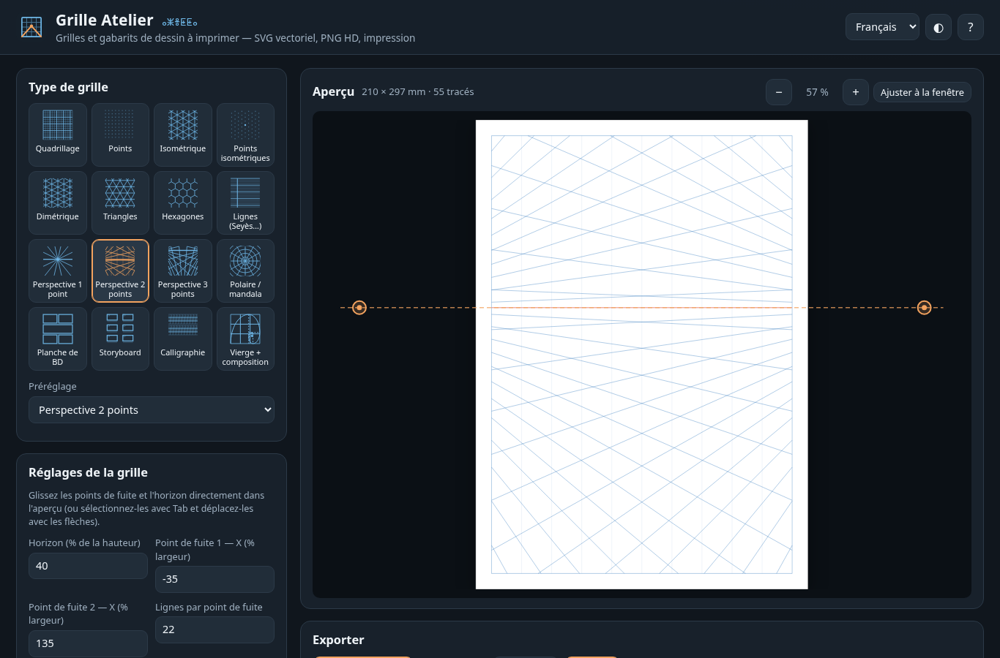
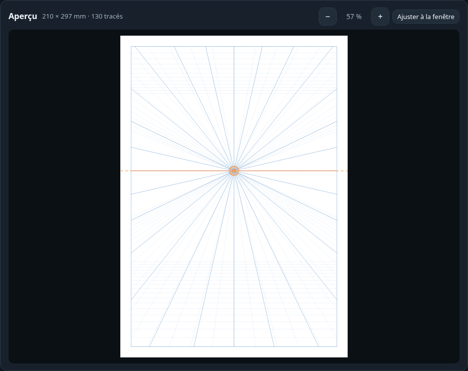
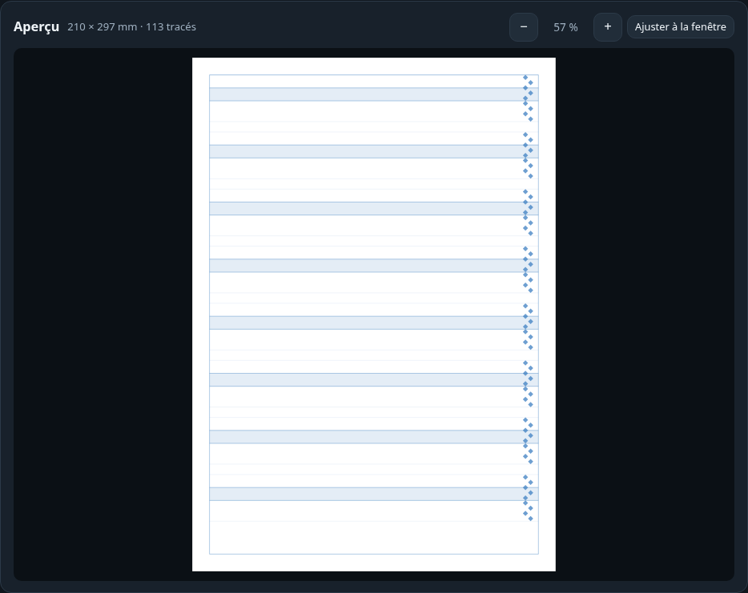
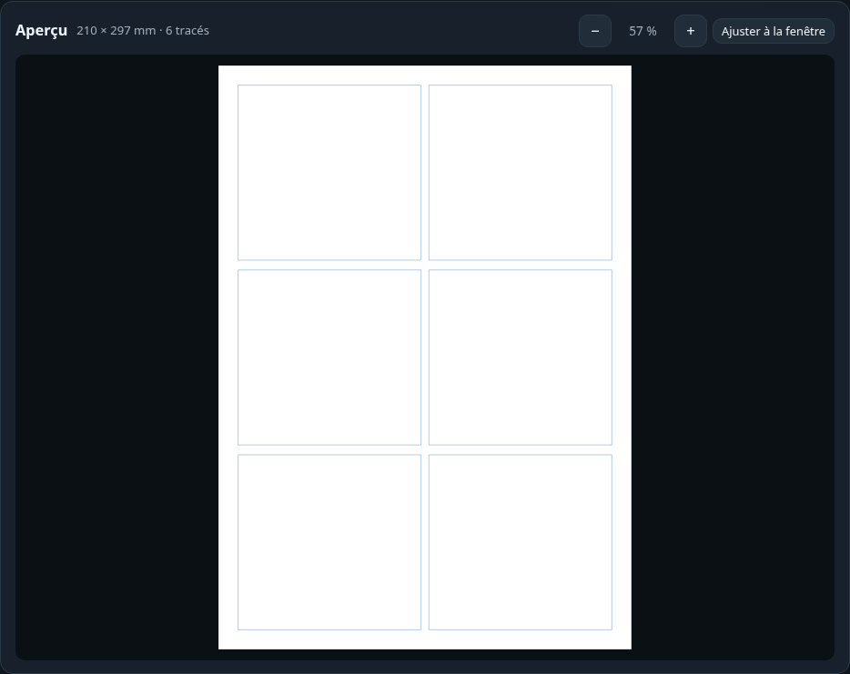
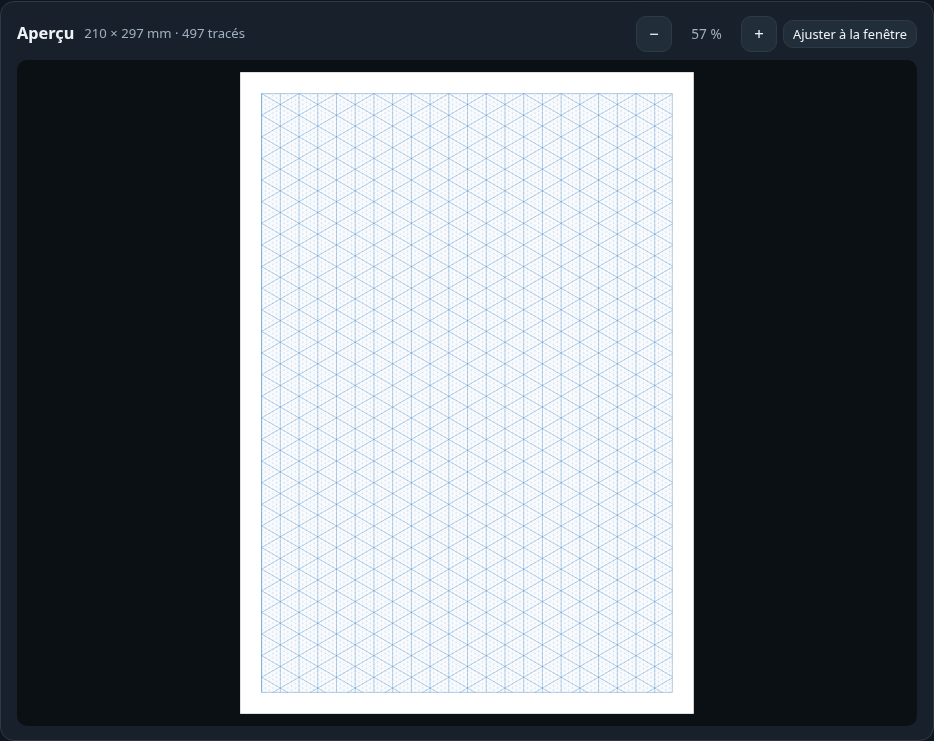
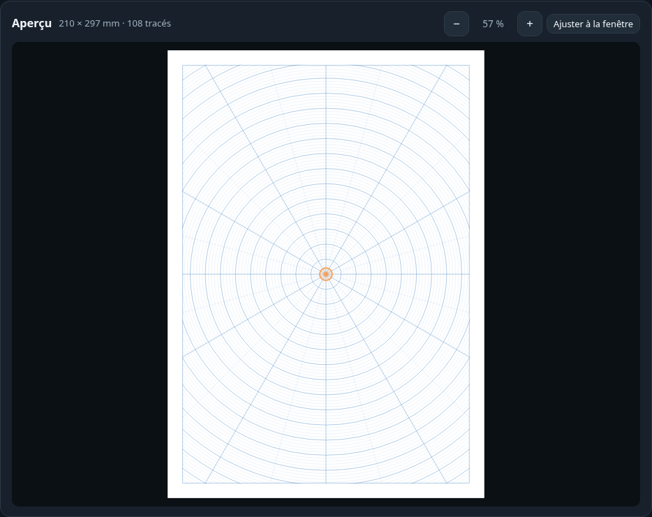
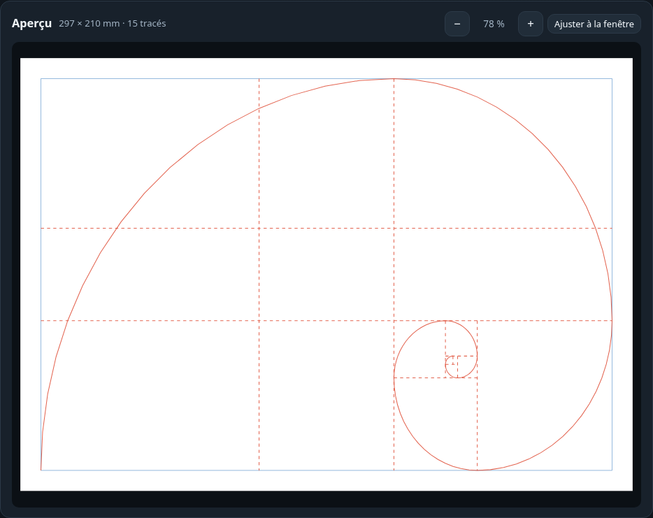
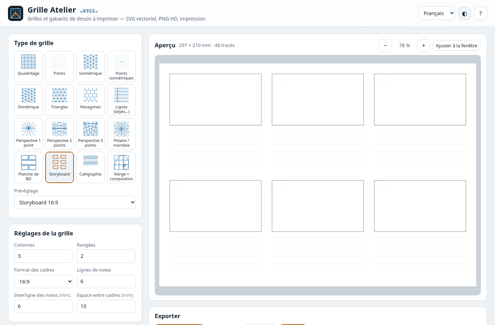
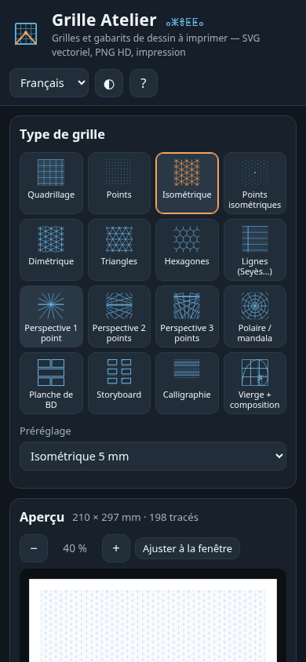

# Grille Atelier 

**Générateur gratuit de grilles et gabarits de dessin à imprimer**, dans le navigateur : quadrillage, points, isométrique, hexagones, perspective 1/2/3 points avec points de fuite déplaçables, grille polaire (mandala), planches de BD, storyboard, guides de calligraphie latine, arabe et tifinagh, repères de composition (tiers, nombre d’or, spirale). Export **SVG vectoriel en millimètres réels**, **PNG 72–600 dpi** (résolution inscrite dans le fichier) et **impression au format exact**.

👉 **Démo : https://salimadour31-boop.github.io/grille-atelier/**

Interface en **français**, **anglais** et **taqbaylit** (avec affichage optionnel en **tifinagh** ⵜⵉⴼⵉⵏⴰⵖ). Aucun compte, aucune clé d’API, aucun traceur : tout est calculé localement, et l’outil fonctionne hors ligne une fois chargé.



## Fonctionnalités

### 16 types de grilles
| Famille | Types et réglages |
|---|---|
| Régulières | **Quadrillage** / papier millimétré (lignes principales + subdivisions), **points** (gros point tous les N), **isométrique** 30° (verticales en option), **points isométriques**, **dimétrique** (angle libre, 26,565° = pixel art 2:1), **triangles**, **hexagones** (pointe ou côté en haut, division en 6 triangles), centrage sur la zone |
| Lignes | **Seyès / grands carreaux**, lignes simples : interligne, subdivisions, verticales, ligne de marge |
| Perspective | **1, 2 et 3 points de fuite** : points de fuite et horizon **déplaçables à la souris, au doigt ou au clavier** dans l’aperçu (ils peuvent sortir de la page), nombre de fuyantes, répartition sur la page ou sur 360°, verticales / horizontales, **dallage de profondeur** exact (sol et plafond, projection 3D réelle) |
| Polaire | **Mandala** : cercles (ou polygones), cercles intermédiaires, secteurs et sous-divisions, centre déplaçable |
| BD & cinéma | **Planche de BD** : syntaxe libre (« 1, 2:1, 3 » = bandes de 1, 2 inégales et 3 cases), hauteurs relatives, gouttières, coins arrondis, 10 mises en page prêtes (6 cases, 9 cases, manga…) ; **storyboard** : colonnes × rangées, format des cadres (16:9, 2.39:1, 1.85:1, 4:3…), case de numéro, lignes de notes |
| Calligraphie | Guides **en largeurs de plume** : hampes, hauteur d’x, capitales, jambages, interligne, **lignes de pente**, ligne médiane, bande teintée, **échelle de points de plume** (losanges). Préréglages : Foundational, italique, gothique, anglaise (copperplate), écriture scolaire, **arabe Naskh / Thuluth / Roqaa** (échelle à droite pour l’écriture de droite à gauche), **tifinagh** (module carré) |
| Composition | Page vierge ou superposée à n’importe quelle grille : **règle des tiers**, **sections d’or**, **spirale d’or** (4 rotations + miroir), **diagonales et réciproques**, repère de centre, **colonnes / rangées de mise en page** avec gouttière |

### Page, style, export
- Formats **A3, A4, A5, A6, B5 JIS (manga), Letter, Legal, Tabloid, comics US, carré, 16:9 (1920 × 1080 px)** ou **taille libre** en **mm, pouces ou px** ; portrait / paysage ; 4 marges ; **fond perdu** (grille prolongeable) et **traits de coupe**.
- Couleur, opacité et épaisseur (mm) séparées pour les **lignes principales, secondaires et repères** ; fond (ou transparent) ; longueur des tirets ; **8 thèmes** (bleu, bleu non reproductible, graphite, sépia, vert d’eau, sanguine, nuit pour tablette, plan bleu).
- **22 préréglages** : papier millimétré, Seyès, points 5 mm (bullet journal), isométrique, pixel art, BD 6 cases, manga B5 avec fond perdu, storyboard 16:9, perspectives, mandala, calligraphies…
- **SVG** vectoriel aux dimensions réelles (mm), un calque par type de ligne (lisible dans Illustrator / Inkscape / Affinity), réglages intégrés dans le fichier (réouvrable dans l’outil).
- **PNG** 72 / 96 / 150 / 300 / 600 dpi, avec la résolution écrite dans le fichier (chunk `pHYs`) pour s’imprimer à la bonne taille.
- **Impression / PDF** : la taille de page exacte est imposée via `@page` (choisir « taille réelle / 100 % »).
- **JSON** : enregistrer / ouvrir ses réglages (ou rouvrir un SVG exporté) ; **lien partageable** : tous les réglages sont dans l’adresse (`#type=persp2&v1x=-0.35…`).
- Rendu **déterministe** (aucun hasard) : les mêmes réglages donnent toujours exactement le même fichier.
- Aperçu en direct avec zoom (boutons, `+` `−` `0`, Ctrl + molette), interface clair / sombre, responsive (bureau et mobile ~390 px), navigable au clavier.

## Utilisation
1. Ouvrez la [démo](https://salimadour31-boop.github.io/grille-atelier/) (ou `index.html` en local : aucun serveur ni installation nécessaires).
2. Choisissez un **type** ou un **préréglage**, ajustez les **réglages**, la **page** et le **style**.
3. En perspective, **faites glisser** les points de fuite et l’horizon dans l’aperçu (ou `Tab` puis flèches, `Maj` = ×10).
4. Exportez en **SVG**, **PNG** ou **imprimez** ; copiez le **lien** pour partager la grille.

Raccourcis : `+` / `−` / `0` zoom, flèches = déplacer le repère sélectionné, `Ctrl+S` = SVG, `Ctrl+P` = imprimer.

## Captures
| Perspective 1 point + dallage | Calligraphie arabe Naskh | Planche de BD |
|---|---|---|
|  |  |  |
| **Isométrique** | **Mandala** | **Nombre d’or + spirale** |
|  |  |  |

| Thème clair — storyboard | Mobile (390 px) |
|---|---|
|  |  |

## Structure
```
index.html          interface
css/style.css       styles (clair / sombre, responsive, impression)
js/geometry.js      unités, formats, découpage Liang–Barsky, tous les générateurs de grilles (sans DOM)
js/settings.js      réglages par défaut, validation, lien (#hash), préréglages, thèmes
js/export.js        SVG (mm, calques), rendu canvas, PNG + DPI (pHYs, CRC-32)
js/i18n.js          textes FR / EN / taqbaylit + translittération tifinagh
js/app.js           interface, aperçu, poignées déplaçables, exports
fonts/              Noto Sans Tifinagh (licence OFL, fichier inclus)
tests/              tests unitaires (Node) et test d’interface (Playwright)
```
HTML / CSS / JavaScript pur, sans dépendance ni étape de compilation.

## Tests
```bash
node tests/geometry.test.js   # 31 tests unitaires : conversions, découpage, réseaux iso/dimétrique/hexagonal,
                              # convergence des fuyantes, dallage en perspective exact, spirale d’or, BD,
                              # storyboard, calligraphie, réglages/lien, SVG, PNG pHYs/CRC, i18n
node tests/ui.test.js         # test d’interface headless (Playwright + Chrome) à 1366 px et 390 px
```
Le test d’interface parcourt les 3 langues (et le tifinagh), les 16 types de grilles, les préréglages, les réglages de page et d’unités, le glisser-déposer et le déplacement au clavier des points de fuite, le zoom, les téléchargements SVG / PNG / JSON (contenu vérifié : dimensions, DPI, métadonnées), l’import JSON et SVG, la restauration par le lien, l’impression (PDF A4 d’une seule page), la réinitialisation, l’absence d’erreurs console et de débordement horizontal sur mobile. Playwright n’est utilisé que pour les tests.

## Licence
Code sous licence **MIT** © 2026 salimadour31-boop — voir [LICENSE](LICENSE). Police **Noto Sans Tifinagh** sous licence SIL Open Font License 1.1 ([fonts/OFL-NotoSansTifinagh.txt](fonts/OFL-NotoSansTifinagh.txt)). Conception, code et icône originaux. Les proportions de calligraphie sont des valeurs pédagogiques courantes, à ajuster selon votre méthode ; les textes en taqbaylit sont une première version — corrections bienvenues.

---

## English summary

**Grille Atelier** is a free, open-source, in-browser generator of printable drawing grids and guide sheets for illustrators, designers, comic / storyboard artists and calligraphers. **16 grid types**: square/graph, dot, isometric, isometric dots, dimetric (2:1 pixel art), triangular, hexagonal, ruled (Seyès), **1-, 2- and 3-point perspective** with vanishing points and horizon you can **drag in the preview** (or move with the keyboard) and exact perspective floor/ceiling tiles, polar/mandala, **comic page layouts** (free “1, 2:1, 3” syntax), **storyboard** sheets, **calligraphy guides** in nib widths (Latin hands, Arabic Naskh/Thuluth/Ruqʿa with right-hand nib ladder, Tifinagh square module), plus **composition overlays** (thirds, golden sections, golden spiral, diagonals, layout columns). Page formats A3–A6, B5, Letter, Legal, Tabloid, US comic, square, 16:9 or custom size in mm/in/px, margins, bleed and crop marks; major/minor/accent line styles and 8 colour themes; 22 presets.

Exports: **true-vector SVG in real millimetres** (one layer per line weight, settings embedded), **PNG at 72–600 dpi** with the resolution stored in the file, **print/PDF at the exact page size** (`@page`), JSON save/load, and a **shareable link** (all settings in the URL hash). Deterministic output, no build step, no trackers, no API keys, works offline. Interface in French, English and Taqbaylit (optional Tifinagh). Tested with 31 Node unit tests and a headless Playwright UI test at 1366 px and 390 px. MIT licence; bundled font under the OFL.

**Demo: https://salimadour31-boop.github.io/grille-atelier/**
